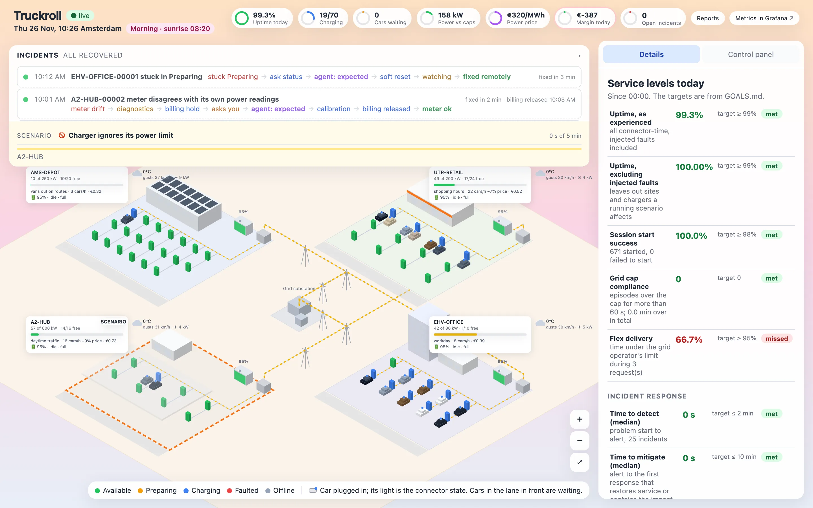
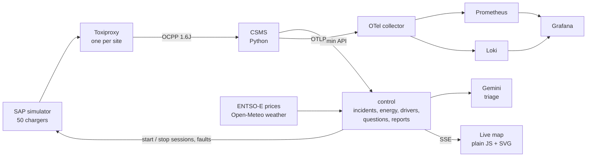

# Truckroll

[](https://github.com/egorsiniaev/truckroll/actions/workflows/ci.yml)
[](https://github.com/egorsiniaev/truckroll/actions/workflows/supply-chain.yml)

A simulated EV charging operator that breaks on purpose, and the operations around it: 50 chargers speaking real
OCPP 1.6J to a backend written here, real Dutch power prices and weather, a fault injected every few minutes, an
incident engine with people in the loop, and an AI triage agent that is scored against what was really injected.

**Live:** [truckroll.siniaev.dev](https://truckroll.siniaev.dev) · **Write-up:** [siniaev.dev/truckroll](https://siniaev.dev/truckroll) · **Engineering log:** [LOG.md](LOG.md)



## What's in it

- **Fleet:** 4 sites, 50 chargers, 70 connectors on the [SAP e-mobility simulator](https://github.com/SAP/e-mobility-charging-stations-simulator),
  each site behind its own [Toxiproxy](https://github.com/Shopify/toxiproxy) so its network can drop, lag or flap.
- **Backend (CSMS):** a thin OCPP 1.6J server on [mobilityhouse/ocpp](https://github.com/mobilityhouse/ocpp) with OpenTelemetry metrics and logs.
- **Energy and drivers:** grid caps, a site controller, batteries, ENTSO-E day-ahead prices, Open-Meteo weather,
  arrivals, queues and driver patience, revenue and margin.
- **Incidents:** 13 scripted fault scenarios plus weather-triggered ones. The incident engine never sees the
  scenario; it detects, responds, verifies and recovers from what an operator would see.
- **People in the loop:** risky steps (reset a charging car, send a technician, free vend) become questions with a
  deadline and a stated default.
- **AI triage:** one Gemini call per incident, read-only queries when unsure, scored against a hidden ledger.
- **Reports:** post-mortems and NIS2 / CRA notification drafts. Rules decide which regime applies; a person approves;
  nothing is ever sent.
- **Observability:** OpenTelemetry collector, Prometheus, Loki and a Grafana dashboard generated from code.

## Results

A snapshot from the live system on 26 Nov 2026. Bad numbers stay in.

**Triage agent**, over 70 scored scenario runs:

| Measure | Result |
|---|---|
| Root cause category right | 77 % (74 % on the first look, before any queries) |
| Strongest | RFID auth slow 9/9, overheating 6/6, storm 6/6, depot offline 5/5 |
| Weakest | stuck connector 2/9: it calls a firmware hang "expected" |
| False "all clear" while a real fault ran | 14 |
| Median time from incident to summary | 20 s |
| Cost | about 700 tokens in, 110 out; about $0.0004 per triage at paid prices |

An early leak let scenario names into the agent's context; scoring restarted from zero after the fix.

**Service levels**, one day:

| Service level | Result | Target |
|---|---|---|
| Uptime as drivers saw it | 99.26 % | ≥ 99 % |
| Session starts that worked | 100 % | ≥ 98 % |
| Grid cap overruns longer than 60 s | 0 | 0 |
| Flex delivery under grid-operator limits | 66.7 % | ≥ 95 % (missed) |
| Questions answered by a person | 12 % | ≥ 50 % (missed) |

What went wrong along the way, including my own wrong theories, is in [LOG.md](LOG.md).

## How it fits together



Everything runs in Docker Compose; the public instance is one small Hetzner server behind Caddy.

## The human gate, and where a real operator should differ

Each agent suggestion becomes a question with a 90 s deadline. At 70 % confidence or more it **goes ahead if
nobody says no**; below that it needs a yes. The question states its default up front.

That is a choice for a simulation: few questions get a human answer, actions come from a fixed list, and they only
touch simulated chargers. A real operator should default agent proposals to no, let only signed-in on-call staff
answer, and always require a yes for anything that costs money or interrupts a driver. Details: [docs/agent.md](docs/agent.md).

## The public demo is open on purpose

Anyone can watch the live map, answer questions and use the control panel; there is no login. It only drives the
simulation. Abuse limits apply instead: per-visitor and global rate limits on changes, a cap on live views
([`control/src/control/guard.py`](control/src/control/guard.py)), a daily cap on AI calls, and Grafana is read-only.

## Run locally

Needs Docker with Compose (Colima works). AI triage and real prices need keys; everything else runs without them.

```bash
cp .env.example .env           # optional: GEMINI_API_KEY, ENTSOE_API_TOKEN
docker compose up -d --build   # the first simulator build takes a few minutes
open http://localhost:8080     # live map, control panel, scenarios
open http://localhost:3000     # Grafana -> Truckroll fleet
docker compose down            # add -v to drop stored metrics, logs and state
```

## Tests

```bash
cd csms && uv run pytest       # 41 tests, 84 % coverage
cd control && uv run pytest    # 141 tests, 85 % coverage
uvx ruff check src tests       # in either service
```

CI runs both on every push, plus an SBOM (Syft) and a vulnerability scan (Grype) that fails on high severity.

## Layout

| Dir | What |
|---|---|
| [`csms/`](csms) | OCPP 1.6J backend, OpenTelemetry |
| [`control/`](control) | Live state, energy and drivers, incidents, questions, triage agent, reports, web API |
| [`web/`](web) | Live map and reports page: plain JavaScript and SVG, no build step |
| [`fleet/`](fleet) | Simulator, site and Toxiproxy config |
| [`observability/`](observability) | OTel collector, Prometheus, Loki, Grafana dashboards |
| [`firmware/`](firmware) | The physical desk charger (ESP32, MicroOcpp): hardware plan, not built yet |
| [`deploy/`](deploy) | Caddy and the server deploy script |
| [`site/`](site) | Source of the write-up page |
| [`docs/`](docs) | Agent design, original spec and plan, an upstream issue draft |

## Safety

Low voltage only. Nothing connects to mains or a real EV.

## License

[MIT](LICENSE). Security reports: [SECURITY.md](SECURITY.md).
